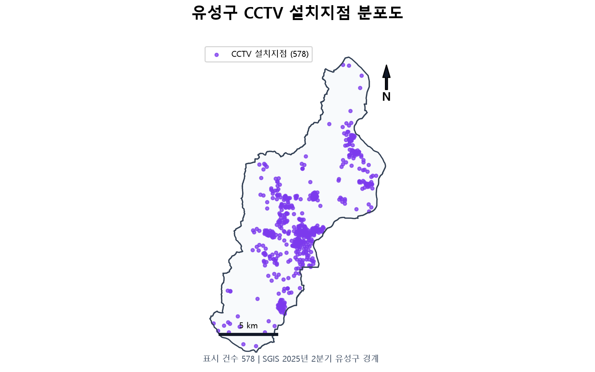
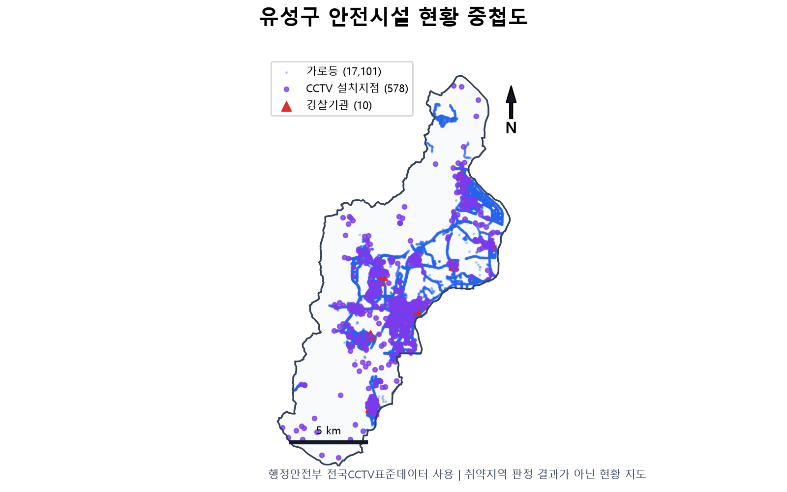
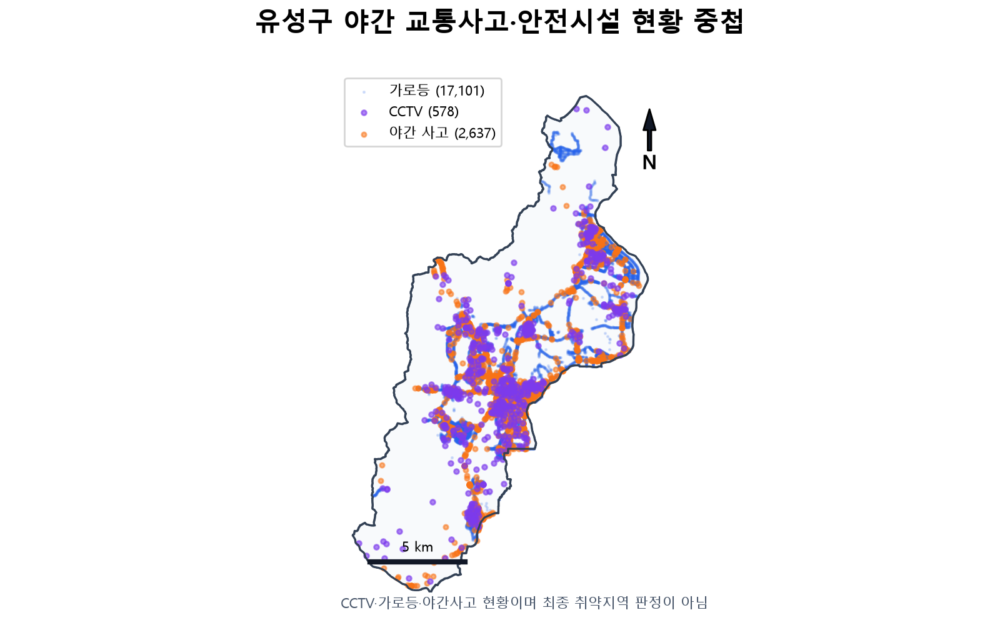
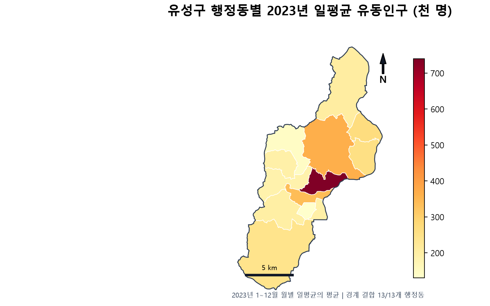

# 유성구 야간 보행 안전 취약지역 분석

## 중간보고 발표자료 구성안 및 발표 원고

> 이 문서는 「유성구 야간 보행 안전 취약지역 분석」 중간보고용 발표자료를 만들기 위한 구성안이다.  
> 현재 단계는 공공데이터 수집·품질점검·전처리·기초 공간분포 시각화까지이며, 종합 취약도 점수와 정책 우선순위는 아직 산출하지 않았다.

---

## 1. 발표의 기본 방향

발표는 다음 흐름으로 구성한다.

> **왜 분석하는가 → 어떤 데이터를 준비했는가 → 어떻게 정리했는가 → 어떤 문제가 있었고 어떻게 해결했는가 → 현재 무엇이 보이는가 → 다음 단계에서 무엇을 할 것인가**

- 권장 발표시간: 8~12분
- 권장 본문: 11장
- 권장 부록: 3~5장
- 발표 성격: 최종 결과보고가 아니라 **데이터 구축 및 기초 공간분석 중간보고**

### 발표에서 반드시 구분할 사항

- 현재 지도는 시설과 사고의 **현황 분포 및 중첩 결과**이다.
- 지도에서 점이 적거나 많다는 이유만으로 취약지역을 확정하지 않는다.
- CCTV 설치지점 수는 실제 촬영범위, 촬영방향, 가동상태를 뜻하지 않는다.
- 일평균 유동인구는 야간 시간대 유동인구와 같지 않다.
- 종합점수 산출을 위한 Min-Max 정규화와 가중치 적용은 다음 단계에서 수행한다.

---

## 2. 권장 목차

1. 분석 개요
2. 데이터 수집 및 구축 현황
3. 데이터 전처리와 정규화
4. 문제점과 해결 과정
5. 기초 통계 및 공간분포 분석
6. 분석 한계 및 향후 계획

---

# 3. 슬라이드별 구성

## 슬라이드 1. 표지

### 제목

**유성구 야간 보행 안전 취약지역 분석**  
데이터 수집·전처리 및 GIS 기초 공간분석 중간보고

### 하단 표기

- 유성구 데이터기반 문제해결단
- 발표자 / 소속 / 발표일

### 발표 멘트 예시

> 이번 발표에서는 취약지역을 최종 선정하는 것이 아니라, 향후 객관적인 취약도 분석을 위해 어떤 데이터를 수집했고 어떻게 정리했는지, 그리고 현재 단계에서 공간적으로 어떤 분포가 확인되는지를 보고드리겠습니다.

---

## 슬라이드 2. 추진 배경 및 분석 목적

### 핵심 메시지

야간 보행 안전은 사고 발생뿐 아니라 안전시설, 보행수요, 취약인구 등 여러 요인을 함께 고려해야 한다.

### 주요 내용

- 야간에는 시야 확보와 주변 감시 여건이 낮아질 수 있다.
- 사고 발생지점만으로는 보행 안전 취약성을 충분히 설명하기 어렵다.
- CCTV·가로등·경찰기관과 같은 보호시설과 유동인구·인구특성을 함께 검토할 필요가 있다.
- 이번 단계의 목적은 분석 가능한 데이터 기반을 구축하고 GIS 지도에 시각화하는 것이다.

### 이번 단계에서 수행하지 않은 사항

- 종합 취약도 점수 산출
- 지표별 가중치 확정
- 취약지역 순위 선정
- 정책 대상지 및 사업 우선순위 확정

### 발표 멘트 예시

> 이번 단계는 결론을 내리는 단계가 아니라, 서로 형식과 기준이 다른 공공데이터를 실제 분석에 사용할 수 있도록 정리하는 단계입니다. 따라서 현재 결과는 현황 파악과 다음 분석을 위한 기반자료로 이해해 주시면 됩니다.

---

## 슬라이드 3. 분석 범위와 전체 절차

### 분석 범위

- 공간 범위: 대전광역시 유성구
- 공간 기준: SGIS 2025년 2분기 시군구·행정동 경계
- 야간 사고 기준: 발생시간이 **20시 이상 또는 6시 미만**
- 주요 분석단위
  - 지점자료: CCTV, 가로등, 버스정류장, 교통사고, 경찰기관
  - 행정동 집계자료: 비상벨, 유동인구, 성·연령별 주민등록인구

### 전체 처리 절차

```text
공공데이터 수집
    ↓
파일 구조·인코딩·컬럼·결측·중복 점검
    ↓
유성구 주소 및 행정구역 1차 필터링
    ↓
좌표값·좌표계 검증과 표준 좌표 생성
    ↓
공식 유성구 경계 point-in-polygon 재검증
    ↓
야간 사고 및 행정동별 지표 산출
    ↓
정적 PNG 지도와 대화형 지도 생성
    ↓
다음 단계: 격자 기반 지표 정규화·취약도 분석
```

### 발표 멘트 예시

> 주소만으로 유성구를 분류하면 경계 인접지역이나 잘못된 좌표가 포함될 수 있기 때문에, 텍스트 필터 후 공식 경계를 이용한 공간 검증을 한 번 더 수행했습니다.

---

## 슬라이드 4. 데이터 수집 및 구축 현황

| 데이터 | 원본 규모 | 최종 분석자료 | 주요 처리 | 상태 |
|---|---:|---:|---|---|
| CCTV | 580개 설치지점 | 578개 설치지점·851대 | 전국표준 WGS84·공식 경계 검증 | 완료 |
| 가로등 | 43,082행 | 17,101개 | 유성구 텍스트 필터 후 경계 검증 | 완료 |
| 버스정류장 | 227,065행 | 790개 | 대전 1차 추출 후 유성구 공간 필터 | 완료 |
| 비상벨 | 61개 법정동 행 | 13개 행정동 | 행정동별 합계·인구 1,000명당 비율 | 완료 |
| 교통사고 | 9,579건 | 경계 내부 9,519건·야간 2,637건 | EPSG:5179·야간 OR 조건 | 완료 |
| 유동인구 | 월별 12개 파일·156행 | 13개 행정동 | 2023년 월별 일평균 통합 | 완료 |
| 성·연령별 인구 | 41,182행 | 13개 행정동 | 최신월·여성·65세 이상 집계 | 완료 |
| 경찰기관 | 10개 | 10개 | 위·경도 컬럼 의미 교정 | 완료 |

### 핵심 메시지

- 계획한 데이터 8종을 모두 확보하고 전처리를 완료했다.
- 모든 원본은 `data_raw`에 보존하고 전처리 결과만 `data_clean`에 저장했다.
- 처리 전후 행 수와 예외사항을 별도 점검표와 로그에 남겼다.

### 활용 자료

- [전처리 현황 워크북](tables/yuseong_interim_status.xlsx)
- [전처리 상세 점검표](tables/preprocessing_summary.csv)

---

## 슬라이드 5. 데이터 전처리 및 정규화 방법

### 1) 파일 형식 정규화

- 원본 CSV를 UTF-8, CP949, EUC-KR 순서로 시험하여 실제 인코딩을 판별했다.
- 원본은 수정하지 않고, 전처리 결과를 한글 호환성이 높은 UTF-8 BOM CSV로 저장했다.
- ZIP 파일은 내부 경로를 검증해 상위폴더 이탈을 방지한 뒤 CSV만 안전하게 추출했다.

### 2) 자료형 정규화

- 위도·경도, 인구수, 시설 수는 숫자형으로 변환했다.
- 사고 발생일시는 날짜·시간형으로 변환했다.
- 관리번호·행정동코드·정류장번호처럼 앞자리 0이 의미를 가질 수 있는 값은 문자열로 보존했다.
- 숫자로 변환할 수 없는 값은 결측으로 처리하고 결측 건수를 기록했다.

### 3) 좌표 정규화

- 좌표값 범위와 원본 메타데이터를 함께 확인했다.
- 거리·공간 연산용 좌표는 `EPSG:5179`로 통일했다.
- 웹 지도와 GeoJSON은 `EPSG:4326`으로 저장했다.
- 모든 점 자료에 다음 공통 필드를 만들었다.
  - `x_5179`, `y_5179`
  - `longitude`, `latitude`
- 국내 위·경도 범위인 경도 124~132, 위도 33~39를 벗어나는 값은 비정상 후보로 분류했다.

### 4) 공간단위 정규화

- 지점자료는 공식 유성구 시군구 경계 내부의 점만 사용했다.
- 비상벨·유동인구·주민등록인구는 13개 행정동 단위로 통일했다.
- 법정동 단위 비상벨 자료는 제공된 행정동코드와 행정동이름을 기준으로 행정동별 합산했다.

### 5) 시간 기준 정규화

- 야간 교통사고는 `발생시간 ≥ 20:00 OR 발생시간 < 06:00`으로 정의했다.
- 유동인구는 2023년 1~12월을 모두 결합해 행정동별 연평균·월 최솟값·월 최댓값을 계산했다.
- 주민등록인구의 `Jan-22`와 같은 기준년월을 날짜로 변환하고 최신월인 2022-01만 사용했다.

### 중요: 아직 하지 않은 정규화

현재 완료한 정규화는 **파일·자료형·좌표계·공간단위·시간 기준의 통일**이다.  
서로 단위가 다른 지표를 0~1 점수로 변환하는 Min-Max 정규화, 방향성 변환, 가중합은 아직 수행하지 않았다.

---

## 슬라이드 6. 전처리 과정에서 발견한 문제와 해결

| 문제 | 확인 방법 | 해결 방법 | 결과 |
|---|---|---|---|
| 기존 CCTV 파일의 좌표가 메타데이터상 EPSG:2097이지만 유성구 경계와 불일치 | 좌표변환 후 경계 내부 점이 0건인지 확인 | 임의 오프셋을 적용하지 않고 행정안전부 전국CCTV표준 WGS84 자료로 교체 | 580개 중 경계 내부 578개·851대 확인 |
| CCTV 주소는 유성구지만 좌표 2건이 경계 밖에 위치 | 주소 필터 결과와 point-in-polygon 결과 비교 | 공식 경계 결과를 우선하여 2건 제외 | 지도 578개 표시 |
| 경찰기관 파일의 위도·경도 컬럼 의미가 반대로 기록 | 위도 컬럼이 127.x, 경도 컬럼이 36.x인지 범위 검사 | 실제 값의 의미를 기준으로 두 컬럼을 교정 | 10개 기관 모두 경계 내부 확인 |
| 전국 버스정류장 자료에 일부 비정상 좌표 존재 | 전체 좌표 범위와 도시명·관리도시명 검사 | 대전 자료를 먼저 추출하고 유성구 경계로 재검증 | 전국 227,065행에서 유성구 790개 확보 |
| 교통사고 야간 조건이 자정을 가로지름 | 시간 조건 논리 검토 | `20시 이상 OR 6시 미만` 사용 | 야간 사고 2,637건 추출 |
| 유동인구 다운로드 파일이 월별 ZIP으로 제공 | ZIP 내부 파일과 실제 컬럼 확인 | 경로 안전성 검사 후 월별 CSV 12개 통합 | 156행·13개 행정동 완전성 확인 |
| 유동인구에 시간대 자료가 없음 | 실제 컬럼이 행정동·월·일평균인지 확인 | 야간 유동인구로 해석하지 않고 일평균 수요지표로 명시 | 과대해석 방지 |
| 비상벨은 법정동 단위이고 다른 자료는 행정동 단위 | 법정동·행정동 코드 동시 확인 | 행정동코드 기준으로 61행을 13개 행정동으로 집계 | 행정동 비교 가능 |
| 데이터별 기준연도가 서로 다름 | 기준일·기준년월 컬럼 확인 | 각 결과와 지도에 기준시점을 기록하고 한계로 명시 | 시점 차이 투명하게 관리 |

### CCTV 문제 해결에서 강조할 점

- 기존 파일에 임의 보정값을 더하거나 주소 지오코딩으로 좌표를 만들어내지 않았다.
- 공식 전국표준데이터로 출처를 변경해 WGS84 좌표를 직접 사용했다.
- 기존 좌표 후보는 `data_clean/01_cctv_legacy_epsg2097_audit.csv`로 보존했다.
- 새 CCTV 자료의 `데이터기준일자`는 2021-10-01이고 갱신시점 최댓값은 2026-05-15이므로 최신 설치·철거 여부는 별도 확인이 필요하다.

### 발표 멘트 예시

> 전처리 과정에서 가장 큰 문제는 CCTV 좌표였습니다. 기존 자료에 적힌 좌표계를 그대로 적용했지만 유성구 경계와 일치하지 않았습니다. 추정 보정값을 적용하는 대신 공식 전국표준 WGS84 자료로 교체했고, 주소와 공식 경계를 이중 확인하여 578개 설치지점을 확정했습니다.

---

## 슬라이드 7. 주요 기초통계

### 핵심 수치

| 지표 | 결과 |
|---|---:|
| CCTV 설치지점 | 578개 |
| CCTV 카메라대수 합계 | 851대 |
| 가로등 | 17,101개 |
| 버스정류장 | 790개 |
| 경찰기관 | 10개 |
| 원본 교통사고 | 9,579건 |
| 유성구 경계 내부 교통사고 | 9,519건 |
| 유성구 경계 내부 야간 교통사고 | 2,637건 |
| 원본 전체 사고 대비 야간 사고 비율 | 27.5% |
| 경계 내부 사고 대비 야간 사고 비율 | 약 27.7% |
| 행정동별 2023년 일평균 유동인구 평균 | 약 266,853명 |

### 해석 시 주의점

- CCTV의 578은 설치지점 수이고 851은 설치지점별 카메라대수의 합계다.
- 가로등 개수는 조도, 고장 여부, 점등시간을 반영하지 않는다.
- 교통사고 원본 9,579건 중 60건은 공식 유성구 경계 밖 좌표로 확인되었다.
- 유동인구 값은 행정동별 일평균이며 야간 시간대 값이 아니다.

---

## 슬라이드 8. 지점자료 공간분포 분석

### 수행한 분석

- CCTV, 가로등, 버스정류장, 야간 교통사고, 경찰기관을 공식 유성구 경계 위에 표시했다.
- 개별 분포도와 안전시설 중첩도를 생성했다.
- 대화형 지도에서는 시설별 레이어를 켜고 끌 수 있도록 구성했다.
- 야간 교통사고는 위치 경향을 쉽게 확인하기 위해 열지도 레이어로도 표현했다.

### CCTV 분포도



### 안전시설 중첩도



### 현재 단계에서 가능한 해석

- 시설이 주거·상업·도로축을 따라 집중되는 공간적 경향을 확인할 수 있다.
- 유성구 외곽과 저밀지역은 시설의 절대 개수가 적게 나타날 수 있다.
- 시설이 많은 곳은 위험해서 보강된 곳일 수도 있고, 인구와 활동량이 많은 곳일 수도 있다.
- 따라서 시설 개수가 많거나 적다는 사실만으로 안전 또는 취약을 판정할 수 없다.

### 발표 멘트 예시

> 시설 분포는 인구와 도로가 집중된 지역을 따라 나타나는 경향이 있습니다. 다만 시설이 많은 지역이 반드시 안전하다고 볼 수는 없습니다. 기존 위험에 대응해 시설이 집중 배치되었을 가능성도 있기 때문에 다음 단계에서는 사고와 보행수요를 함께 비교해야 합니다.

---

## 슬라이드 9. 야간 사고와 안전시설 중첩 분석



### 분석 방법

- 야간 사고 2,637건을 CCTV 578개 설치지점 및 가로등 17,101개와 중첩했다.
- 동일 지도에서 사고와 안전시설의 공간적 겹침을 시각적으로 비교했다.
- 아직 버퍼, 최근접 거리, 격자별 밀도와 같은 수치형 공간지표는 계산하지 않았다.

### 현재 단계의 관찰

- 사고와 안전시설이 모두 밀집한 구간이 존재한다.
- 이는 시설이 부족하지 않다는 결론이 아니라, 통행량·도로구조·상업활동 등 다른 요인의 영향 가능성을 의미한다.
- 시설이 드문 외곽지역은 사고 건수도 적게 보일 수 있으므로 노출량을 고려하지 않은 단순 건수 비교는 주의해야 한다.

### 발표 시 권장 표현

> “사고와 시설의 공간적 중첩이 확인되었다.”  
> “추가적인 거리·밀도 분석이 필요한 후보 양상이 관찰되었다.”

### 피해야 할 표현

> “이 지역이 가장 위험하다.”  
> “CCTV가 부족해서 사고가 발생했다.”  
> “시설을 추가하면 사고가 감소할 것이다.”

---

## 슬라이드 10. 보행수요 및 인구특성 분석

### 유동인구 처리

- 2023년 1~12월 월별 파일 12개를 통합했다.
- 13개 행정동별 일평균 유동인구의 연평균·월 최솟값·월 최댓값을 계산했다.
- 13개 행정동 모두 12개월 자료가 있는지 확인했다.



### 주민등록인구 처리

- 최신 기준월 2022-01 자료를 사용했다.
- 행정동별 총인구, 여성인구·비율, 65세 이상 인구·비율을 산출했다.
- 행정동별 여성인구 비율 평균: 약 49.5%
- 행정동별 고령인구 비율 평균: 약 11.3%

### 비상벨 처리

- 61개 법정동 행을 13개 행정동으로 집계했다.
- 행정동별 비상벨 수와 인구 1,000명당 비상벨 수를 계산했다.

### 해석상 한계

- 유동인구는 일평균이므로 야간 보행량을 직접 의미하지 않는다.
- 행정동 평균은 동 내부의 세부적인 공간 차이를 보여주지 못한다.
- 인구자료와 다른 시설자료의 기준시점이 일치하지 않는다.

---

## 슬라이드 11. 현재 성과, 한계 및 향후 계획

### 현재까지의 성과

- 공공데이터 8종과 공식 행정경계를 확보했다.
- 원본 파일 구조, 인코딩, 컬럼, 결측, 중복, 좌표 범위를 점검했다.
- 지점자료의 좌표계를 통일하고 유성구 경계 내부 자료를 확정했다.
- 야간 교통사고와 행정동별 보행수요·인구지표를 생성했다.
- 발표용 정적 지도 7개와 레이어형 대화형 지도를 생성했다.
- 전처리 과정과 처리 건수를 재현 가능한 코드와 점검표로 남겼다.

### 현재 한계

1. 데이터 기준시점이 서로 다르다.
2. CCTV 촬영범위·방향·가동상태를 알 수 없다.
3. 가로등 조도·고장·점등시간 정보가 없다.
4. 유동인구가 야간 시간대로 구분되지 않는다.
5. 행정동 자료는 세부 위치 차이를 나타내지 못한다.
6. 현재 지도는 단순 분포와 중첩이며 인과관계를 설명하지 않는다.

### 다음 단계

1. 유성구를 100m 또는 250m 격자로 분할
2. 격자별 야간 사고 건수·밀도 산출
3. CCTV·가로등 밀도와 최근접 거리 산출
4. 버스정류장·유동인구·여성·고령인구 등 보행수요 지표 결합
5. 지표 방향 통일 및 0~1 정규화
6. 동일가중치 기준점수 산출
7. 가중치 변화에 따른 민감도 분석
8. 상위 후보지역 현장 또는 로드뷰 검증

### 마무리 멘트 예시

> 이번 단계에서는 데이터 품질을 확인하고 공간적으로 비교 가능한 형태까지 정리했습니다. 다음 단계에서는 동일한 격자 단위로 사고·시설·수요 지표를 계산하고, 정규화와 가중치 민감도 분석을 거쳐 취약지역 후보를 도출하겠습니다.

---

# 4. 정규화 방법 상세 설명

## 4.1 현재 단계에서 완료한 정규화

| 구분 | 적용 내용 | 목적 |
|---|---|---|
| 인코딩 | CP949 등 원본을 판별하고 결과는 UTF-8 BOM으로 저장 | 한글 깨짐 방지 |
| 자료형 | 좌표·인구·시설 수는 숫자, 코드·관리번호는 문자열 | 계산 오류 및 코드 손실 방지 |
| 좌표계 | 공간연산 EPSG:5179, 웹지도 EPSG:4326 | 데이터 간 위치 비교 가능 |
| 좌표 필드 | `x_5179`, `y_5179`, `longitude`, `latitude` 생성 | 후속 분석의 공통 입력 구조 |
| 공간범위 | 공식 유성구 경계 내부 점만 사용 | 주소 오류·경계 밖 좌표 제거 |
| 행정단위 | 법정동 또는 원자료를 13개 행정동으로 집계 | 자료 간 결합 가능 |
| 시간 | 야간 20:00~06:00, 월별 유동인구 2023년 통합 | 동일 기준 비교 |
| 비율 | 비상벨/인구×1,000, 여성인구/총인구, 65세 이상/총인구 | 규모가 다른 행정동 비교 |

## 4.2 다음 단계에서 적용할 통계적 정규화

서로 단위가 다른 사고 건수, 시설 밀도, 인구 비율, 거리 값을 합산하려면 0~1 범위로 변환해야 한다.

### 위험 증가형 지표

값이 클수록 취약도가 높아지는 지표에 적용한다.

- 야간 사고 건수 또는 밀도
- 보행수요 또는 유동인구
- 취약인구 비율
- 경찰기관·안전시설까지의 거리

```text
정규화 점수 = (관측값 - 최솟값) / (최댓값 - 최솟값)
```

### 보호시설 공급형 지표

CCTV·가로등처럼 값이 클수록 보호 여건이 좋아진다고 가정하는 지표는 방향을 반대로 변환한다.

```text
보호시설 부족도 = 1 - {(관측값 - 최솟값) / (최댓값 - 최솟값)}
```

### 거리형 지표

가까울수록 보호효과가 높다고 보는 시설까지의 거리는 값이 클수록 취약한 방향이므로 일반 Min-Max 값을 그대로 사용할 수 있다.

```text
거리 취약도 = (거리 - 최소거리) / (최대거리 - 최소거리)
```

### 이상치 처리 검토

사고나 유동인구가 일부 격자에 지나치게 집중될 경우 Min-Max 결과가 압축될 수 있다. 다음 방법을 비교한다.

- `log1p` 변환 후 정규화
- 상·하위 1% 절단 또는 Winsorization
- 분위수 순위 정규화

이상치 처리 방법은 결과 민감도를 비교한 뒤 결정하며 현재 단계에서는 적용하지 않았다.

### 가중치 적용 계획

초기 기준안은 동일가중치로 시작한다.

```text
종합 취약도 = Σ(정규화 지표 × 지표 가중치)
```

이후 사고, 시설부족, 보행수요, 취약인구의 가중치를 변화시켜 상위 후보지역이 얼마나 달라지는지 민감도 분석을 수행한다. 가중치가 달라질 때 순위가 크게 변하는 지역은 정책 판단 전에 추가 검증이 필요하다.

---

# 5. 데이터별 세부 전처리 기록

## 5.1 CCTV

1. 기존 유성구 CCTV 파일의 좌표범위와 메타데이터를 점검했다.
2. EPSG:2097로 변환했을 때 유성구 경계 내부가 0건으로 확인되었다.
3. 좌표에 임의 오프셋을 적용하지 않고 기존 결과를 감사용으로 보존했다.
4. 행정안전부 전국CCTV표준데이터에서 대전유성구 기관코드 `3670000` 자료를 확보했다.
5. 도로명주소와 지번주소를 결합해 유성구 주소 여부를 확인했다.
6. `WGS84경도`, `WGS84위도`를 숫자형으로 변환하고 국내 범위를 검사했다.
7. 공식 유성구 경계 내부 점만 남겼다.
8. 580개 중 2개를 경계 밖 좌표로 제외하고 578개 설치지점을 저장했다.
9. 설치지점별 `카메라대수`를 합산해 총 851대를 산출했다.

## 5.2 가로등

1. 대전 전체 43,082행을 읽었다.
2. `행정읍면동`에 유성구가 포함된 17,266행을 1차 추출했다.
3. WGS84 위·경도를 숫자형으로 변환했다.
4. 공식 유성구 경계로 재검증해 17,101개를 확정했다.

## 5.3 버스정류장

1. 전국 227,065행을 읽고 좌표범위를 확인했다.
2. `도시명` 또는 `관리도시명`에 대전이 포함된 3,245행을 먼저 추출했다.
3. 비정상 좌표 후보를 제거했다.
4. 공식 유성구 경계 내부 790개 정류장을 확정했다.

## 5.4 비상벨

1. 61개 법정동 행에 포함된 행정동코드와 행정동이름을 확인했다.
2. 행정동별 비상벨 수와 인구수를 합산했다.
3. 행정동별 포함 법정동 수를 계산했다.
4. `비상벨 수 / 인구수 × 1,000`으로 인구 1,000명당 비상벨 수를 산출했다.
5. 13개 행정동 자료로 저장했다.

## 5.5 교통사고

1. 원본 9,579건의 `발생일시`를 날짜·시간형으로 변환했다.
2. 원본 투영좌표 EPSG:5179를 WGS84와 공통 좌표필드로 변환했다.
3. 공식 유성구 경계 내부 9,519건을 확인했다.
4. `시간 ≥ 20 OR 시간 < 6` 조건으로 야간 사고 2,637건을 추출했다.
5. 원본 전체 정제자료와 야간 사고자료를 각각 저장했다.

## 5.6 유동인구

1. ZIP 내부 경로를 검증하고 CSV 12개만 추출했다.
2. 월별 파일을 합쳐 총 156행을 만들었다.
3. 행정동·월·일평균 컬럼을 실제 파일에서 확인했다.
4. 행정동별 12개월 일평균의 평균·최솟값·최댓값을 계산했다.
5. 13개 행정동 모두 12개월 자료가 있는지 확인했다.
6. 시간대 컬럼이 없으므로 야간 유동인구라는 표현을 사용하지 않았다.

## 5.7 성·연령별 주민등록인구

1. 원본 41,182행에서 유성구 자료를 필터링했다.
2. `Jan-22` 형식의 기준년월을 운영체제 언어설정에 의존하지 않고 날짜로 변환했다.
3. 최신 기준월 2022-01 자료만 사용했다.
4. 행정동별 총인구를 합산했다.
5. 성별이 여성인 행을 합산해 여성인구와 여성비율을 계산했다.
6. 연령이 65세 이상인 행을 합산해 고령인구와 고령인구 비율을 계산했다.

## 5.8 경찰기관

1. 원본 위도 컬럼이 127.x, 경도 컬럼이 36.x인 것을 발견했다.
2. 한국 좌표범위를 기준으로 컬럼의 실제 의미가 뒤바뀐 것으로 판정했다.
3. 위도 컬럼의 값을 경도, 경도 컬럼의 값을 위도로 사용했다.
4. 공식 유성구 경계로 재검증해 10개 기관을 확정했다.

---

# 6. 현재 수행한 분석과 수행하지 않은 분석

## 현재 수행한 분석

- 데이터별 행 수·열 수·결측·중복·좌표범위 점검
- 주소·행정구역 텍스트 필터링
- 공식 경계를 활용한 point-in-polygon 공간 필터
- 좌표계 변환 및 공통 좌표필드 생성
- 야간 교통사고 시간대 필터
- 행정동별 비상벨·유동인구·인구특성 집계
- 지점 분포도 작성
- 시설·사고 중첩 지도 작성
- 행정동 유동인구 단계구분도 작성
- Folium 기반 레이어형 대화형 지도 작성

## 아직 수행하지 않은 분석

- 격자별 사고·시설 밀도
- 시설까지의 최근접 거리
- CCTV 촬영범위 또는 가시권 분석
- 야간 시간대 유동인구 분석
- 도로망·보행로 기반 네트워크 거리
- 지표 간 상관관계 또는 인과분석
- Min-Max 또는 Z-score 기반 종합점수
- 가중치 결정과 취약지역 순위
- 정책효과 추정

---

# 7. 발표자료 디자인 권장안

## 색상 체계

- CCTV: 보라색
- 가로등: 파란색
- 야간 교통사고: 주황색
- 경찰기관: 빨간색 삼각형
- 유동인구: 노랑→주황→빨강 단계색
- 설명 및 경계: 남색·회색

## 슬라이드 배치

- 한 장에 핵심 메시지는 1개만 둔다.
- 지도 슬라이드는 지도를 화면의 60~70% 이상 사용한다.
- 통계는 전체 표보다 4~6개의 큰 숫자 카드로 제시한다.
- 지도 하단에는 반드시 다음 문구를 넣는다.

> 현황 분포 및 중첩 결과이며 최종 취약지역 판정 결과가 아님

## 시각자료 파일

- `maps/01_cctv_distribution.png`
- `maps/02_streetlights_distribution.png`
- `maps/03_bus_stops_distribution.png`
- `maps/04_night_traffic_accidents.png`
- `maps/05_safety_facilities_combined.png`
- `maps/06_night_accidents_and_facilities.png`
- `maps/07_population_or_floating_population_by_dong.png`
- `maps/yuseong_night_safety_map.html`

---

# 8. 예상 질문과 답변

## Q1. CCTV가 578개인가, 851대인가?

578은 좌표가 있는 설치지점 수이고, 851은 각 설치지점의 카메라대수를 합산한 값이다. 공간분포 지도에는 설치지점 578개가 표시된다.

## Q2. 왜 기존 유성구 CCTV 파일을 사용하지 않았는가?

기존 파일은 메타데이터의 EPSG:2097을 적용해도 유성구 경계와 일치하지 않았다. 좌표에 임의 보정값을 적용하면 결과의 객관성을 설명하기 어려우므로, WGS84 좌표가 제공되는 행정안전부 전국표준데이터의 유성구 자료로 교체했다.

## Q3. 사고가 많은 곳이 바로 취약지역인가?

아니다. 사고 건수는 통행량이 많은 곳에서 높아질 수 있으며 안전시설, 보행수요, 도로구조와 함께 검토해야 한다. 현재는 사고 분포를 확인한 단계다.

## Q4. CCTV와 가로등이 많으면 안전한가?

단정할 수 없다. 시설이 위험지역에 대응해 추가 설치되었을 수도 있고, CCTV 촬영방향이나 가로등 조도도 반영되지 않았다. 다음 단계에서 시설 밀도와 거리 지표를 보행수요 및 사고지표와 함께 분석해야 한다.

## Q5. 정규화와 가중치는 어떻게 정할 것인가?

우선 모든 지표를 방향에 맞춰 0~1 범위로 정규화하고 동일가중치를 기준안으로 사용한다. 이후 사고·시설부족·보행수요·취약인구 가중치를 변경하여 결과가 얼마나 달라지는지 민감도 분석을 수행한다.

## Q6. 유동인구를 야간 보행수요로 사용할 수 있는가?

현재 자료에는 시간대 구분이 없어 직접적인 야간 보행수요로 사용할 수 없다. 이번 단계에서는 행정동의 전반적인 활동 규모를 보여주는 보조지표로만 사용하며, 가능하면 향후 시간대별 보행량 또는 생활이동 자료로 보완해야 한다.

---

# 9. 최종 요약 문안

> 유성구 야간 보행 안전 분석을 위해 CCTV, 가로등, 버스정류장, 비상벨, 교통사고, 유동인구, 성·연령별 주민등록인구, 경찰기관 등 8종의 공공데이터를 구축하였다. 파일 인코딩과 자료형을 정리하고, 좌표계를 공간연산용 EPSG:5179와 웹지도용 EPSG:4326으로 통일했으며, 공식 유성구 경계를 이용해 지점자료를 재검증하였다. 특히 기존 CCTV 좌표 불일치 문제는 임의 보정 대신 행정안전부 전국CCTV표준데이터로 교체하여 578개 설치지점과 851대의 카메라를 확인하였다. 현재 단계에서는 야간 교통사고 2,637건과 안전시설·보행수요의 공간분포를 시각화했으며, 이는 최종 취약지역 판정이 아닌 기초 현황분석 결과이다. 다음 단계에서는 격자별 밀도와 거리 지표를 계산하고, 지표 방향 통일·정규화·가중치 민감도 분석을 거쳐 취약지역 후보를 도출할 예정이다.

